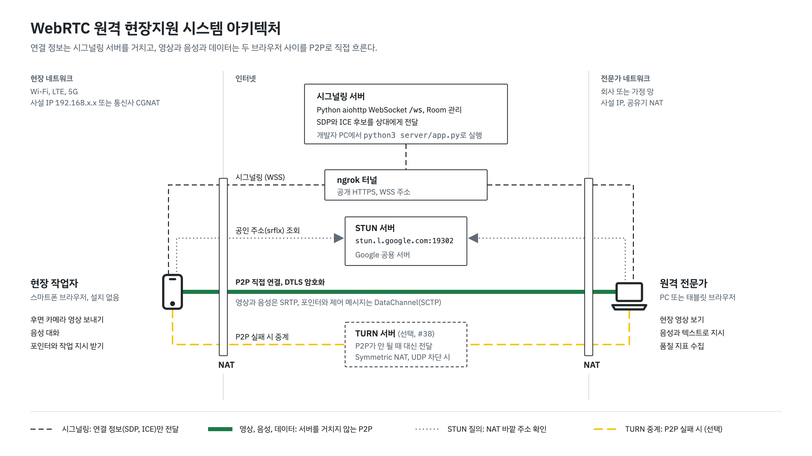
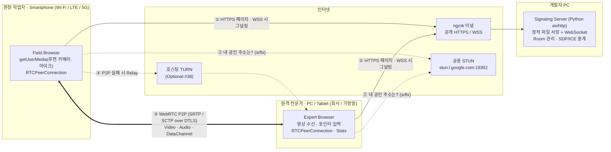
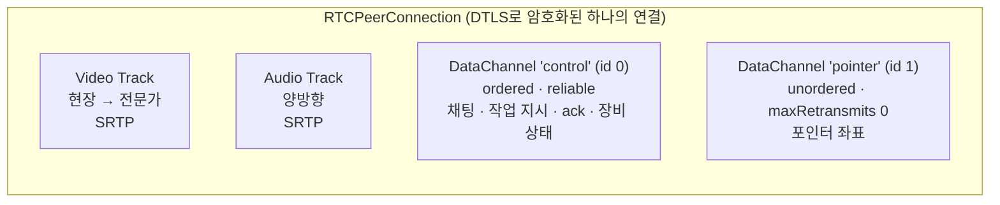
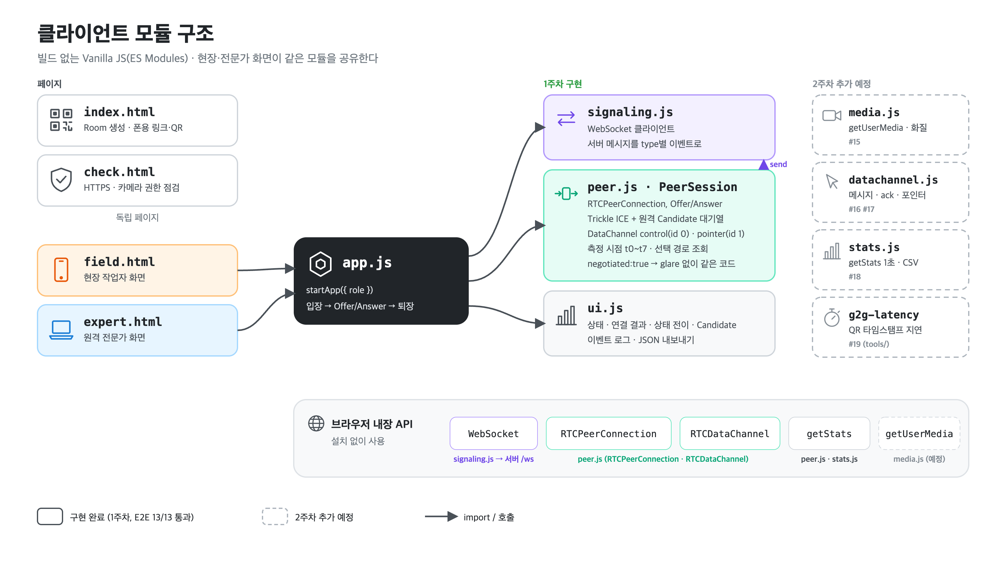
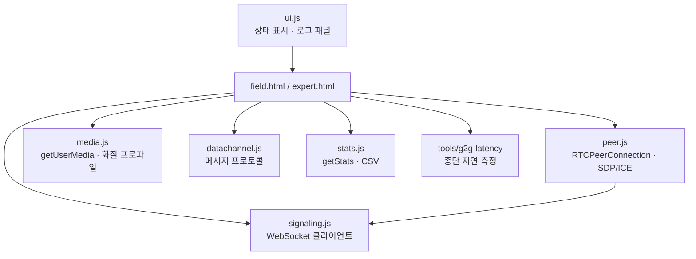
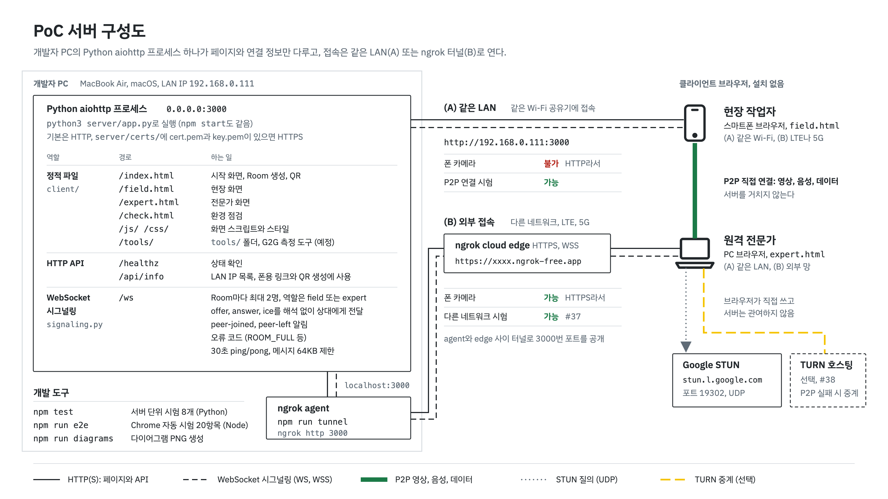
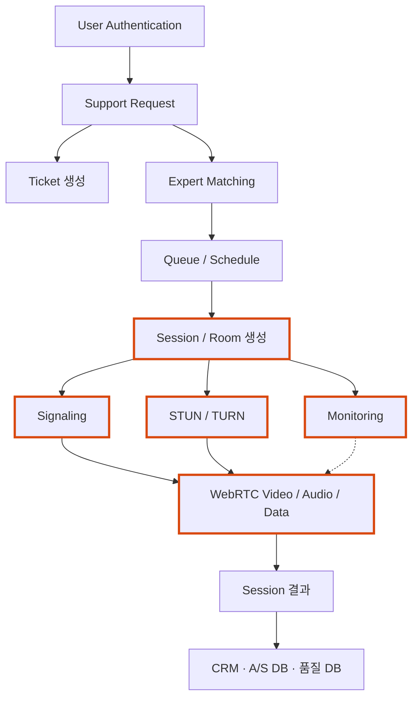

# 02. System Architecture

> 상태: v1.0 (1주차) · 관련 이슈 #4 · 요구사항: [01-requirements.md](01-requirements.md)
> 다이어그램은 Mermaid로 이 문서 안에 둔다 (GitHub에서 렌더링).

## 1. 전체 구조

아래는 같은 구조의 Mermaid 버전이다 (텍스트로 수정하기 쉬움).

**핵심:** 시그널링 서버는 연결 정보(SDP, ICE Candidate)만 중계한다. 영상·음성·DataChannel은 서버를 거치지 않고 두 브라우저 사이를 P2P로 흐른다. 그래서 시그널링 서버가 영상 트래픽을 감당할 필요가 없다. 대신 P2P가 실패하면 TURN Relay가 필요하다.

## 2. 구성 요소와 필요한 이유

| 구성 요소 | 역할 | 왜 필요한가 | 없으면 |
|---|---|---|---|
| Field Browser | 카메라·마이크 획득, 영상 송출, 포인터 표시, 장비 정보 전송 | 설치 없이 현장 단말을 쓰기 위해 | — |
| Expert Browser | 영상 수신, 음성, 포인터·지시 송신, 품질 지표 수집 | 전문가가 별도 프로그램 없이 지원하기 위해 | — |
| Signaling Server | Room 관리, 상대 입장 알림, SDP/ICE 중계 | 처음 만나는 두 브라우저는 서로의 주소와 미디어 능력을 모른다. WebRTC 표준은 이 교환 방법을 정하지 않는다 | 연결을 시작할 수 없다 |
| ngrok 터널 | 개발자 PC의 서버를 공개 HTTPS/WSS 주소로 노출 | 모바일 `getUserMedia`는 HTTPS가 필요하고, LTE의 폰이 개발자 PC에 접속해야 한다 | 폰 카메라 사용 불가, 다른 네트워크에서 시그널링 불가 |
| STUN | 단말에 NAT 바깥에서 보이는 공인 주소·포트를 알려줌 (srflx Candidate) | 사설 IP(192.168.x.x)만으로는 인터넷 너머의 상대가 접속할 수 없다 | 다른 네트워크 간 P2P 불가 |
| TURN (Optional) | P2P가 불가능할 때 미디어를 중계 | Symmetric NAT, UDP 차단 방화벽에서는 STUN으로 얻은 주소로도 연결되지 않는다 | 해당 환경에서 연결 실패 |

## 3. Media / Data 배치

- **영상·음성은 MediaStream Track**으로 보낸다. 코덱, 대역폭 적응(혼잡 제어), 지터 버퍼를 브라우저가 처리한다.
- **부가 데이터는 RTCDataChannel**로 보낸다. 같은 P2P 연결을 쓰므로 서버를 거치지 않고, 지연이 영상과 비슷하다.
- DataChannel은 요구 특성이 다른 두 채널로 나눈다 (근거: [01 §5](01-requirements.md#5-교환-데이터와-요구-특성)).
  - `control`: 작업 지시는 늦더라도 반드시, 순서대로 도착해야 한다.
  - `pointer`: 오래된 좌표를 재전송하면 오히려 포인터가 늦게 따라온다. 잃어버린 좌표는 버리고 최신 값만 쓴다.

## 4. 클라이언트 모듈 구조

## 5. 배포 구성 (PoC)

| 대상 | 위치 | 비고 |
|---|---|---|
| Signaling Server + 정적 파일 | 개발자 PC (`python3 server/app.py`) | Python aiohttp 단일 프로세스, Room은 메모리에 보관 |
| 외부 노출 | ngrok (`npm run tunnel`) | 무료 플랜은 실행할 때마다 URL이 바뀜 |
| STUN | Google 공용 STUN | 비용 없음, SLA 없음 |
| TURN | 없음 → 필요 시 호스팅 TURN (#38) | 자체 구축 안 함 |

## 6. 실제 서비스 전체 구조 안에서의 PoC 범위

과제 명세 §38의 기업 원격지원 플랫폼 중 **굵은 테두리** 부분만 만든다. 나머지는 Think 항목으로 분석한다 (#26).

| 범위 | 포함 |
|---|---|
| PoC로 구현 | Room 생성·입장, Signaling, STUN, WebRTC Media/Data, 품질 측정(Monitoring의 축소판) |
| 분석만 | 인증, 지원 요청·Ticket, 전문가 배정·Queue, TURN 운영, Session 결과 연동(CRM, A/S DB) |

## 7. 이 구조가 잘 동작하는 환경과 문제가 생기는 환경

| 잘 동작 | 문제 가능 | 대응 |
|---|---|---|
| 같은 LAN, 일반 가정용 공유기(Cone NAT) | 이동통신망 CGNAT·Symmetric NAT | srflx 연결 실패 시 TURN 필요 (#37, #38) |
| UDP 허용 네트워크 | UDP 차단 기업·공장 방화벽 | TURN over TCP/TLS 443 |
| 사용자 2명 | 다자간 지원 | Mesh는 업링크 한계 → SFU 검토 (#27) |
| 개발자 PC가 켜져 있을 때 | 시그널링 서버 장애·재시작 | 이미 연결된 통화는 유지. 운영 시 서버 이중화 (#26) |
