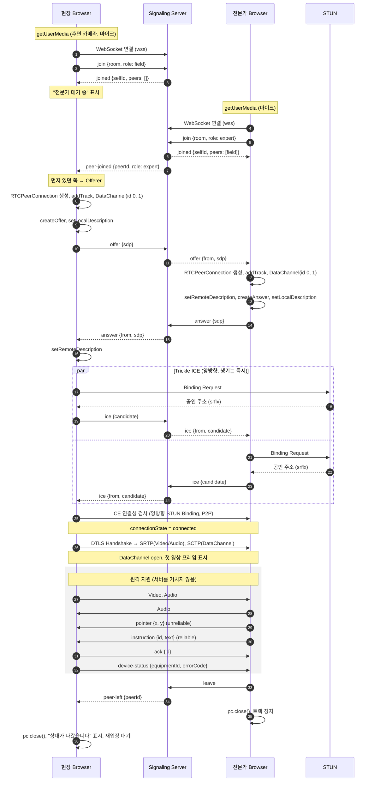
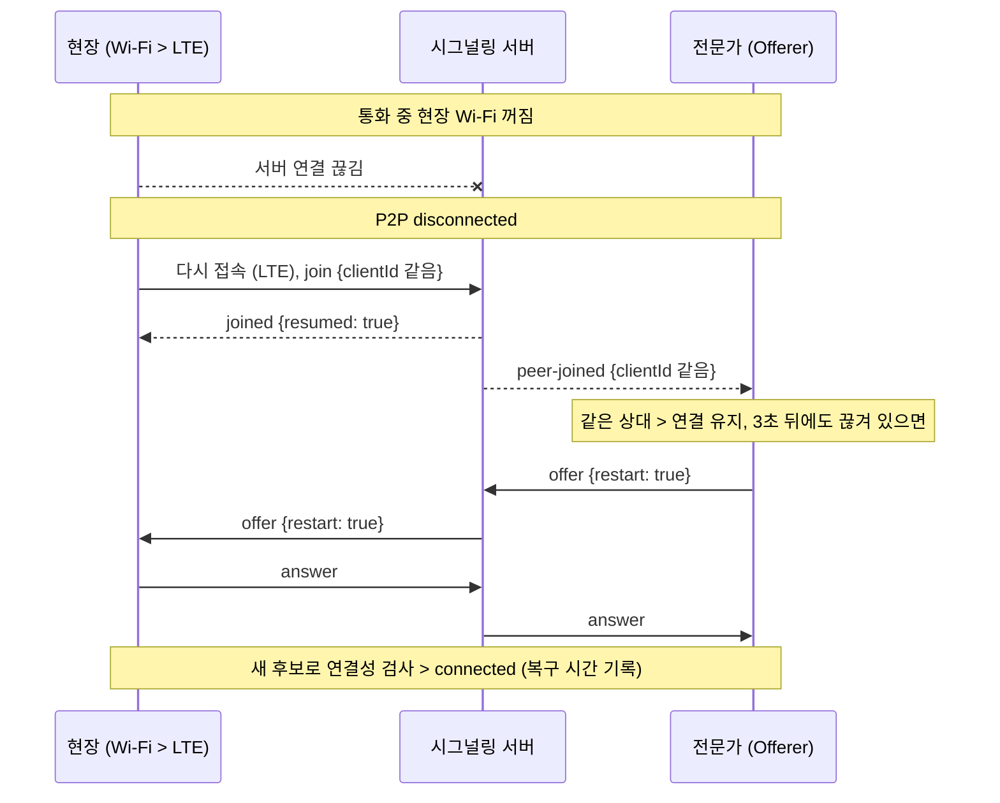
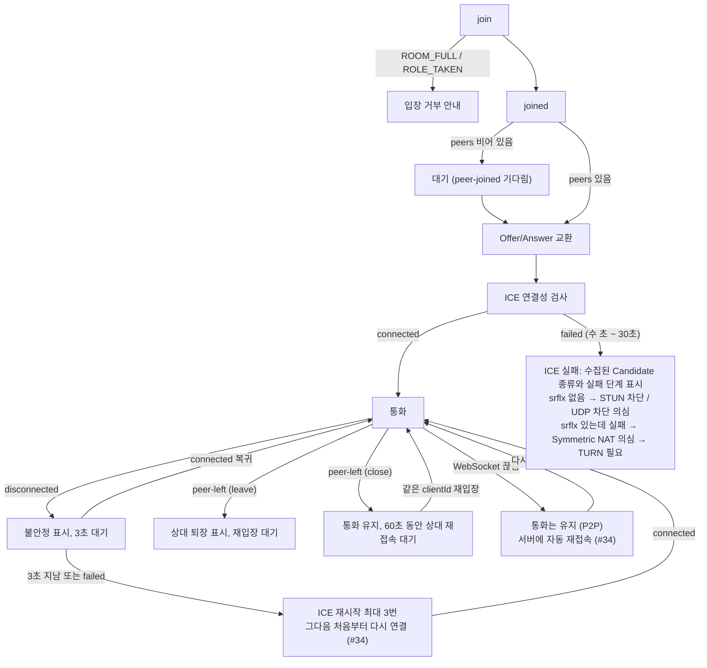
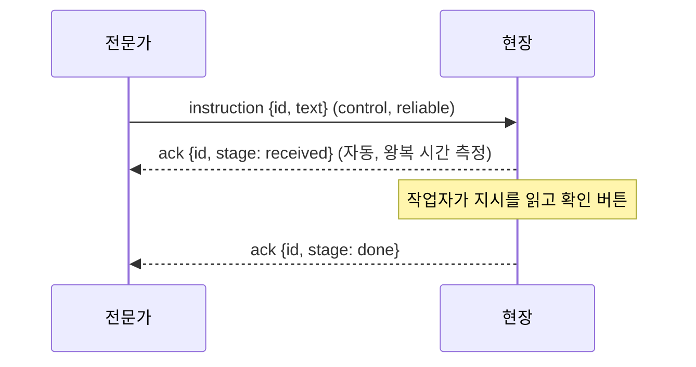

# 03. Connection Sequence 및 Signaling 메시지 스펙

> 상태: v1.0 (1주차, 구현 전 설계) · 관련 이슈 #5 · 구현(#9, #10) 후 실제 동작에 맞춰 v2로 갱신한다.

## 1. 기본 규칙

| 규칙 | 내용 | 이유 |
|---|---|---|
| Room 정원 | 2명 (현장 1, 전문가 1) | 1:1 지원이 Core 범위 |
| Offer를 만드는 쪽 | **Room에 먼저 있던 쪽**이 `peer-joined`를 받으면 Offer를 만든다 | 두 쪽이 동시에 Offer를 만드는 충돌(glare)을 구조적으로 막는다. 서버가 `peer-joined`를 기존 참가자에게만 보내므로 Offerer가 항상 한 명이다 |
| ICE | Trickle ICE: Candidate가 생기는 즉시 보낸다 | 모든 Candidate 수집을 기다리지 않아 연결 시간이 줄어든다 |
| DataChannel | 양쪽이 `negotiated: true`로 같은 id(0: `control`, 1: `pointer`)를 미리 만든다. 메시지 형식은 §6 | `ondatachannel` 이벤트에 의존하지 않아 Offerer가 누구든 같은 코드로 동작한다 |
| 서버 역할 | 메시지를 상대에게 그대로 전달할 뿐 SDP·Candidate 내용을 해석하지 않는다 | 서버를 단순하게 유지. 영상은 서버를 지나지 않는다 |
| 미디어 통로 | Offerer가 첫 offer 전에 송수신 통로 3개(음성, 카메라, 화면 공유)를 연다. 켜고 끌 때는 `replaceTrack`만 하고, 상태는 `control` 채널의 `media` 메시지로 알린다 | 재협상 없이 켜고 끈다 (TD-13). 구현 #15, #62 |

## 2. 정상 흐름: 입장 → 연결 → 지원 → 종료

현장 작업자가 먼저 들어오고, 전문가가 나중에 들어오는 경우다. 순서가 바뀌어도 "먼저 있던 쪽이 Offer"라는 규칙만 적용된다.

## 3. Signaling 메시지 스펙

모든 메시지는 WebSocket 텍스트 프레임의 JSON 객체이고 `type` 필드를 가진다.

### 클라이언트 → 서버

| type | 필드 | 설명 |
|---|---|---|
| `join` | `room: string`, `role: "field" \| "expert"`, `name?: string`, `clientId?: string` | Room 입장. `clientId`는 탭마다 정하는 번호(새로고침하면 바뀜). 서버에 다시 붙을 때 같은 번호로 자리를 이어받는다 (#34) |
| `offer` | `sdp: RTCSessionDescriptionInit`, `restart?: true` | 상대에게 전달. `restart`는 ICE 재시작 offer (기존 연결에 적용) |
| `answer` | `sdp: RTCSessionDescriptionInit` | 상대에게 전달 |
| `ice` | `candidate: RTCIceCandidateInit \| null` | 상대에게 전달. `null`은 수집 완료 |
| `leave` | — | Room 퇴장 (WebSocket 종료도 퇴장으로 처리) |

### 서버 → 클라이언트

| type | 필드 | 설명 |
|---|---|---|
| `joined` | `selfId: string`, `room: string`, `peers: {id, role, name, clientId}[]`, `resumed: boolean` | 입장 성공. `peers`가 비어 있으면 대기. `resumed`는 옛 자리를 이어받았음 |
| `peer-joined` | `peer: {id, role, name, clientId}`, `resumed: boolean` | 기존 참가자에게만 전송 → 받은 쪽이 Offerer. 지금 연결된 상대와 `clientId`가 같으면 연결을 새로 만들지 않는다 |
| `offer` / `answer` / `ice` | `from: string` + 원래 필드 | 상대가 보낸 메시지를 그대로 전달 |
| `peer-left` | `peerId: string`, `reason: "leave" \| "close"` | `leave`는 스스로 나감(연결 정리). `close`는 서버 연결만 끊김: P2P가 살아 있으면 60초 동안 유지하고 돌아오기를 기다린다 |
| `error` | `code: string`, `message: string` | 아래 오류 코드 |

### 오류 코드

| code | 상황 | 클라이언트 동작 |
|---|---|---|
| `ROOM_FULL` | 이미 2명 | 입장 불가 안내 |
| `ROLE_TAKEN` | 같은 역할이 이미 있음 | 역할 확인 안내 |
| `NOT_IN_ROOM` | join 전에 offer/answer/ice 전송 | 버그. 로그에 남김 |
| `NO_PEER` | 상대 없이 offer/answer/ice 전송 | 무시하고 로그에 남김 |
| `ALREADY_JOINED` | 이미 Room에 있는데 다시 `join` | 버그. 로그에 남김 |
| `BAD_MESSAGE` | JSON 파싱 실패, 필드 누락 | 버그. 로그에 남김 |

### 연결 유지

서버는 30초마다 WebSocket ping을 보내고, pong이 없으면 연결을 닫고 상대에게 `peer-left`(`reason: close`)를 보낸다. 폰의 화면이 꺼지거나 네트워크가 바뀌어 TCP가 조용히 끊긴 경우를 감지하기 위해서다.

### 재접속과 연결 복구 (#24, #34)

시그널링 서버 연결과 P2P 연결은 따로 끊긴다. 둘을 따로 되살린다.

| 끊긴 것 | 감지 | 대응 | 담당 |
|---|---|---|---|
| 서버 연결(WebSocket) | `close` 이벤트 | 1, 2, 4, 5, 5…초 뒤 다시 접속, 같은 `clientId`로 `join`. 서버가 옛 연결을 아직 모르면 옛 연결을 닫고 자리를 넘긴다(`resumed`). P2P는 건드리지 않는다 | 양쪽 |
| P2P (`disconnected`) | `connectionState` | 3초 기다림(저절로 회복하기도 함) > ICE 재시작 | Offerer |
| P2P (`failed`) | `connectionState` | 바로 ICE 재시작. 8초마다 최대 3번 > 그래도 안 되면 처음부터 다시 연결(새 `RTCPeerConnection`). 10초마다 | Offerer |
| 상대가 오래 안 돌아옴 | `peer-left(close)` 뒤 60초 | 연결 정리, 재입장 대기 | 양쪽 |

- **ICE 재시작:** 같은 `RTCPeerConnection`에서 `restartIce()`로 후보만 새로 찾는다. 암호화 키와 미디어 통로(TD-13)는 그대로라 화면이 다시 붙는 데 필요한 일이 적다. 네트워크가 바뀌어(Wi-Fi > LTE) 옛 주소가 쓸모없어졌을 때 쓴다.
- **Offerer만 재시작:** 양쪽이 동시에 offer를 만들면 충돌(glare)한다. 처음 연결 제안을 보낸 쪽이 재시작도 맡는다.
- **복구 시간(Recovery Time):** 끊김을 감지한 시각부터 다시 `connected`가 된 시각까지. 화면 '연결 결과' 표의 '복구' 행과 기록 JSON의 `recoveries`(`lostAt`, `why`, `recoveryMs`, `how`)에 남는다.
- 한 번도 연결되지 않은 실패(#37처럼 처음부터 길이 없음)는 복구하지 않고 연결 실패로 남긴다.

## 4. 실패 분기

| 단계 | 성공 판단 | 실패 시 남길 로그 | 사용자 안내 |
|---|---|---|---|
| 페이지 접속 | 페이지 로드 | — | URL·네트워크 확인 |
| 권한 | `getUserMedia` 성공 | 오류 이름 (`NotAllowedError` 등) | 브라우저 설정에서 권한 허용 |
| 시그널링 | `joined` 수신 | WebSocket close code | 서버 주소·네트워크 확인 |
| SDP 교환 | `setRemoteDescription` 성공 | 예외 메시지 | 재시도 |
| ICE | `connectionState=connected` | 수집된 Candidate 목록, 상태 전이 시간 | 다른 네트워크로 시도 또는 TURN 필요 |
| Media | 첫 프레임 표시, 수신 bytes 증가 | `inbound-rtp` 통계 | 카메라 사용 중인 다른 앱 종료 |
| DataChannel | `open` 이벤트 | readyState | 재연결 |

## 5. 측정 시점 (Connection Time 정의)

측정(#13, #37)에서 쓰는 시각을 미리 정한다. 각 단말이 자기 `performance.now()`로 기록한다.

| 표기 | 시점 |
|---|---|
| t0 | 나중에 들어온 쪽이 `join`을 보낸 시각 |
| t1 | Offerer가 `peer-joined`를 받은 시각 |
| t2 | `offer` 송신 |
| t3 | `answer` 수신 |
| t4 | 첫 ICE Candidate 송신 |
| t5 | `connectionState = connected` |
| t6 | DataChannel `control` open |
| t7 | 첫 영상 프레임 표시 (`requestVideoFrameCallback`) |

- **Connection Time = t5 − t0**: 나중에 들어온 쪽 단말에서 측정한다. t0과 t5가 같은 단말의 시계라 기기 간 시계 동기화가 필요 없다.
- **Time to First Frame = t7 − t0**: 전문가가 나중에 들어오는 시나리오에서 전문가 단말이 측정한다. 사용자 체감에 가장 가깝다.
- t1 ~ t4는 지연이 어느 구간(시그널링 왕복, ICE 검사, DTLS)에서 생기는지 나누어 보기 위해 기록한다.

## 6. DataChannel 메시지 스펙 (#16)

구현: `client/js/datachannel.js`. 시그널링 서버를 거치지 않고 두 브라우저 사이에서 직접 오간다.

### 봉투

모든 메시지는 같은 JSON 봉투에 담는다: `{ type, seq, ts, payload }`

| 필드 | 뜻 |
|---|---|
| `type` | 메시지 종류 (아래 표) |
| `seq` | 보내는 쪽이 채널마다 0부터 1씩 올리는 번호. 순서 확인과 늦게 온 포인터 버리기에 쓴다 |
| `ts` | 보낸 시각(ms, Unix epoch). 기기 시계가 달라 지연 계산에는 쓰지 않고 기록용으로만 쓴다 |
| `payload` | 종류별 내용 |

받는 쪽은 JSON 형식, `type`, 채널 일치, `seq`, 필수 필드, 좌표 범위(0~1)를 검사하고, 틀리면 버리고 오류 기록에 남긴다.

### 종류

| type | 채널 | payload | 방향 | 설명 |
|---|---|---|---|---|
| `chat` | control | `{text}` | 양쪽 | 채팅. 500자 제한 |
| `instruction` | control | `{id, text}` | 전문가 > 현장 | 작업 지시. 확인(ack)을 받는다 |
| `ack` | control | `{id, stage}` | 현장 > 전문가 | `stage`: `received`(앱이 받음, 자동) 또는 `done`(작업자가 확인 버튼을 누름) |
| `device-status` | control | `{equipmentId, state, errorCode, temperature}` | 현장 > 전문가 | 장비 상태 (PoC는 더미 값) |
| `media` | control | `{slot, on}` | 양쪽 | 카메라·마이크·화면 공유 켜짐 알림 (TD-13) |
| `profile` | control | `{profile}` | 전문가 > 현장 | 화질 변경 요청 (`A` 또는 `B`) |
| `ping` / `pong` | control | `{t}` | 양쪽 | 데이터 통로 왕복 시간 확인 |
| `pointer` | pointer | `{x, y, down}` | 전문가 > 현장 | 영상 위 위치. 영상 크기와 상관없이 0~1로 정규화 |

### 작업 지시의 확인 흐름

- 도착 확인(`received`)을 받지 못한 지시는 대기열에 남는다. 연결이 끊겼다가 다시 열리면 대기열의 지시를 다시 보낸다.
- 받는 쪽은 `id`로 중복을 거른다. 중복이어도 `ack`는 다시 보내서, 보낸 쪽이 확인을 받게 한다.
- `control` 채널은 순서 보장과 재전송을 하므로 연결이 살아 있는 동안에는 유실되지 않는다. 대기열은 연결 자체가 끊긴 경우를 위한 것이다.

### 포인터

- `pointer` 채널은 순서를 보장하지 않고 재전송도 하지 않는다(`ordered: false`, `maxRetransmits: 0`).
- 받는 쪽은 지금까지 받은 가장 큰 `seq`보다 작거나 같은 좌표를 버린다. 건너뛴 번호 수는 유실 추정치로 센다(`counts.pointerGap`).
- 보내는 쪽 대기열(`bufferedAmount`)이 16KB를 넘으면 새 좌표를 보내지 않는다. 밀린 좌표를 늦게 보내는 것보다 최신 좌표만 보내는 편이 낫다.
