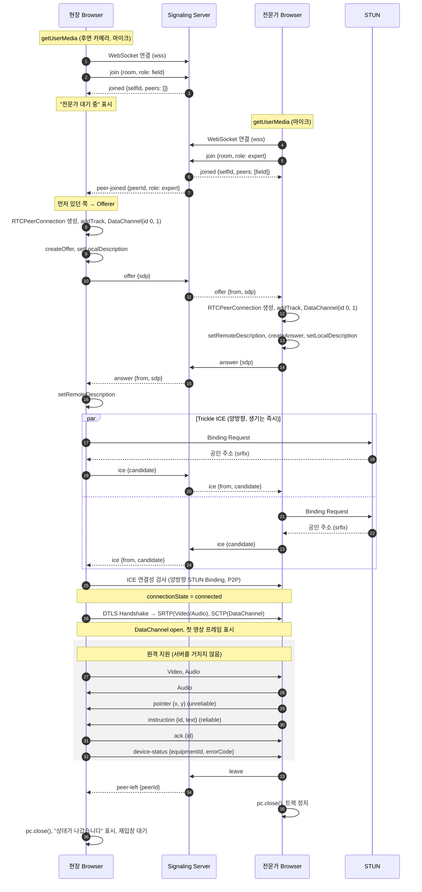
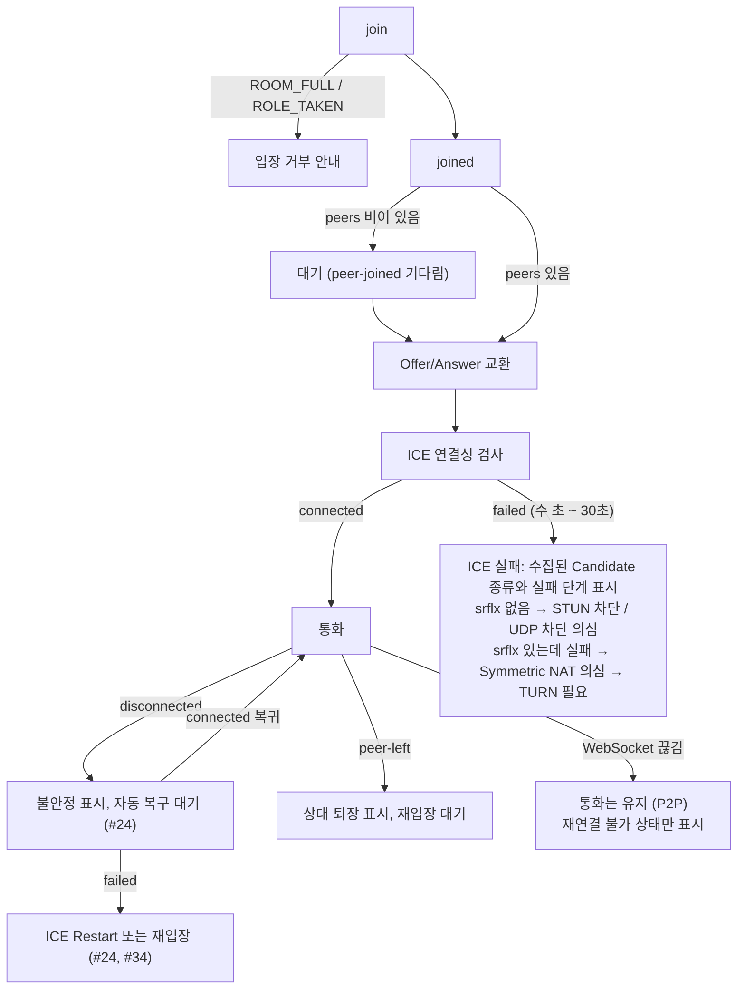

# 03. Connection Sequence 및 Signaling 메시지 스펙

> 상태: v1.0 (1주차, 구현 전 설계) · 관련 이슈 #5 · 구현(#9, #10) 후 실제 동작에 맞춰 v2로 갱신한다.

## 1. 기본 규칙

| 규칙 | 내용 | 이유 |
|---|---|---|
| Room 정원 | 2명 (현장 1, 전문가 1) | 1:1 지원이 Core 범위 |
| Offer를 만드는 쪽 | **Room에 먼저 있던 쪽**이 `peer-joined`를 받으면 Offer를 만든다 | 두 쪽이 동시에 Offer를 만드는 충돌(glare)을 구조적으로 막는다. 서버가 `peer-joined`를 기존 참가자에게만 보내므로 Offerer가 항상 한 명이다 |
| ICE | Trickle ICE: Candidate가 생기는 즉시 보낸다 | 모든 Candidate 수집을 기다리지 않아 연결 시간이 줄어든다 |
| DataChannel | 양쪽이 `negotiated: true`로 같은 id(0: `control`, 1: `pointer`)를 미리 만든다 | `ondatachannel` 이벤트에 의존하지 않아 Offerer가 누구든 같은 코드로 동작한다 |
| 서버 역할 | 메시지를 상대에게 그대로 전달할 뿐 SDP·Candidate 내용을 해석하지 않는다 | 서버를 단순하게 유지. 영상은 서버를 지나지 않는다 |
| 미디어 통로 | Offerer가 첫 offer 전에 송수신 통로 3개(음성, 카메라, 화면 공유)를 연다. 켜고 끌 때는 `replaceTrack`만 하고, 상태는 `control` 채널의 `media` 메시지로 알린다 | 재협상 없이 켜고 끈다 (TD-13). 구현 #15, #62 |

## 2. 정상 흐름: 입장 → 연결 → 지원 → 종료

현장 작업자가 먼저 들어오고, 전문가가 나중에 들어오는 경우다. 순서가 바뀌어도 "먼저 있던 쪽이 Offer"라는 규칙만 적용된다.

## 3. Signaling 메시지 스펙

모든 메시지는 WebSocket 텍스트 프레임의 JSON 객체이고 `type` 필드를 가진다.

### 클라이언트 → 서버

| type | 필드 | 설명 |
|---|---|---|
| `join` | `room: string`, `role: "field" \| "expert"`, `name?: string` | Room 입장 |
| `offer` | `sdp: RTCSessionDescriptionInit` | 상대에게 전달 |
| `answer` | `sdp: RTCSessionDescriptionInit` | 상대에게 전달 |
| `ice` | `candidate: RTCIceCandidateInit \| null` | 상대에게 전달. `null`은 수집 완료 |
| `leave` | — | Room 퇴장 (WebSocket 종료도 퇴장으로 처리) |

### 서버 → 클라이언트

| type | 필드 | 설명 |
|---|---|---|
| `joined` | `selfId: string`, `room: string`, `peers: {id, role, name}[]` | 입장 성공. `peers`가 비어 있으면 대기 |
| `peer-joined` | `peer: {id, role, name}` | 기존 참가자에게만 전송 → 받은 쪽이 Offerer |
| `offer` / `answer` / `ice` | `from: string` + 원래 필드 | 상대가 보낸 메시지를 그대로 전달 |
| `peer-left` | `peerId: string` | 상대 퇴장 또는 WebSocket 끊김 |
| `error` | `code: string`, `message: string` | 아래 오류 코드 |

### 오류 코드

| code | 상황 | 클라이언트 동작 |
|---|---|---|
| `ROOM_FULL` | 이미 2명 | 입장 불가 안내 |
| `ROLE_TAKEN` | 같은 역할이 이미 있음 | 역할 확인 안내 |
| `NOT_IN_ROOM` | join 전에 offer/answer/ice 전송 | 버그. 로그에 남김 |
| `NO_PEER` | 상대 없이 offer/answer/ice 전송 | 무시하고 로그에 남김 |
| `ALREADY_JOINED` | 이미 Room에 있는데 다시 `join` | 버그. 로그에 남김 |
| `BAD_MESSAGE` | JSON 파싱 실패, 필드 누락 | 버그. 로그에 남김 |

### 연결 유지

서버는 30초마다 WebSocket ping을 보내고, pong이 없으면 연결을 닫고 상대에게 `peer-left`를 보낸다. 폰의 화면이 꺼지거나 네트워크가 바뀌어 TCP가 조용히 끊긴 경우를 감지하기 위해서다.

## 4. 실패 분기

| 단계 | 성공 판단 | 실패 시 남길 로그 | 사용자 안내 |
|---|---|---|---|
| 페이지 접속 | 페이지 로드 | — | URL·네트워크 확인 |
| 권한 | `getUserMedia` 성공 | 오류 이름 (`NotAllowedError` 등) | 브라우저 설정에서 권한 허용 |
| 시그널링 | `joined` 수신 | WebSocket close code | 서버 주소·네트워크 확인 |
| SDP 교환 | `setRemoteDescription` 성공 | 예외 메시지 | 재시도 |
| ICE | `connectionState=connected` | 수집된 Candidate 목록, 상태 전이 시간 | 다른 네트워크로 시도 또는 TURN 필요 |
| Media | 첫 프레임 표시, 수신 bytes 증가 | `inbound-rtp` 통계 | 카메라 사용 중인 다른 앱 종료 |
| DataChannel | `open` 이벤트 | readyState | 재연결 |

## 5. 측정 시점 (Connection Time 정의)

측정(#13, #37)에서 쓰는 시각을 미리 정한다. 각 단말이 자기 `performance.now()`로 기록한다.

| 표기 | 시점 |
|---|---|
| t0 | 나중에 들어온 쪽이 `join`을 보낸 시각 |
| t1 | Offerer가 `peer-joined`를 받은 시각 |
| t2 | `offer` 송신 |
| t3 | `answer` 수신 |
| t4 | 첫 ICE Candidate 송신 |
| t5 | `connectionState = connected` |
| t6 | DataChannel `control` open |
| t7 | 첫 영상 프레임 표시 (`requestVideoFrameCallback`) |

- **Connection Time = t5 − t0**: 나중에 들어온 쪽 단말에서 측정한다. t0과 t5가 같은 단말의 시계라 기기 간 시계 동기화가 필요 없다.
- **Time to First Frame = t7 − t0**: 전문가가 나중에 들어오는 시나리오에서 전문가 단말이 측정한다. 사용자 체감에 가장 가깝다.
- t1 ~ t4는 지연이 어느 구간(시그널링 왕복, ICE 검사, DTLS)에서 생기는지 나누어 보기 위해 기록한다.
