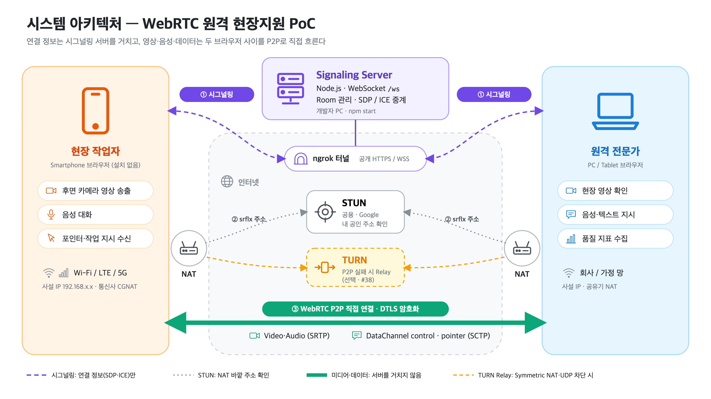
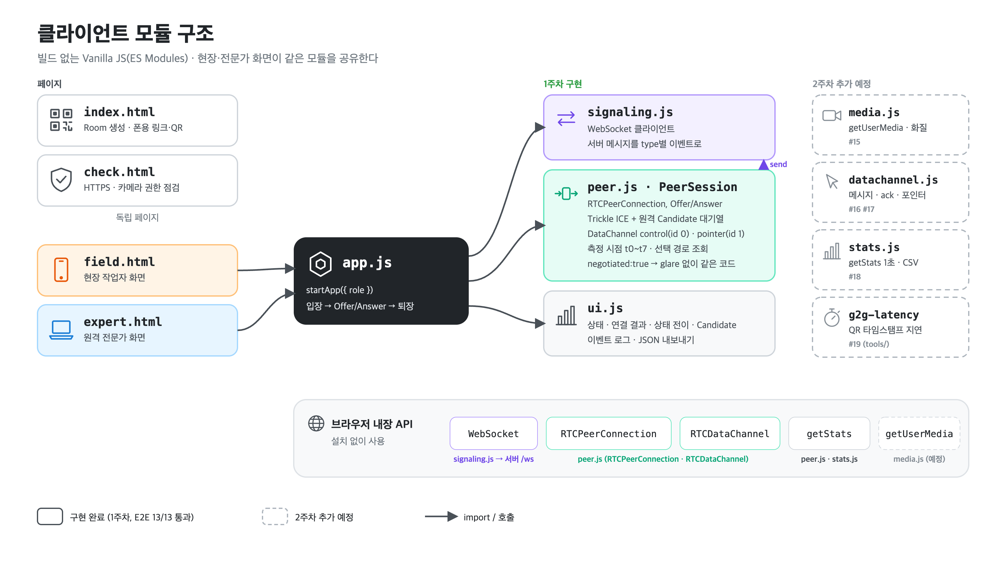
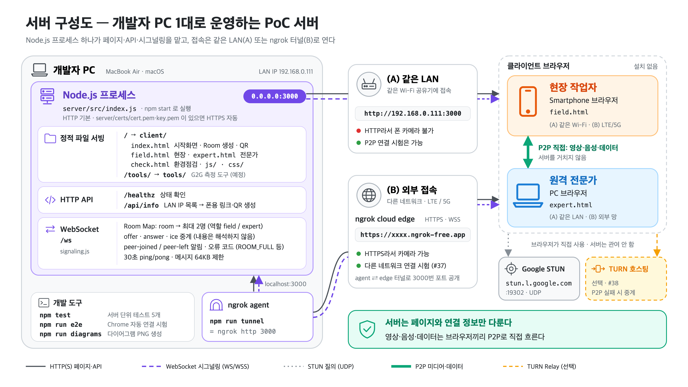
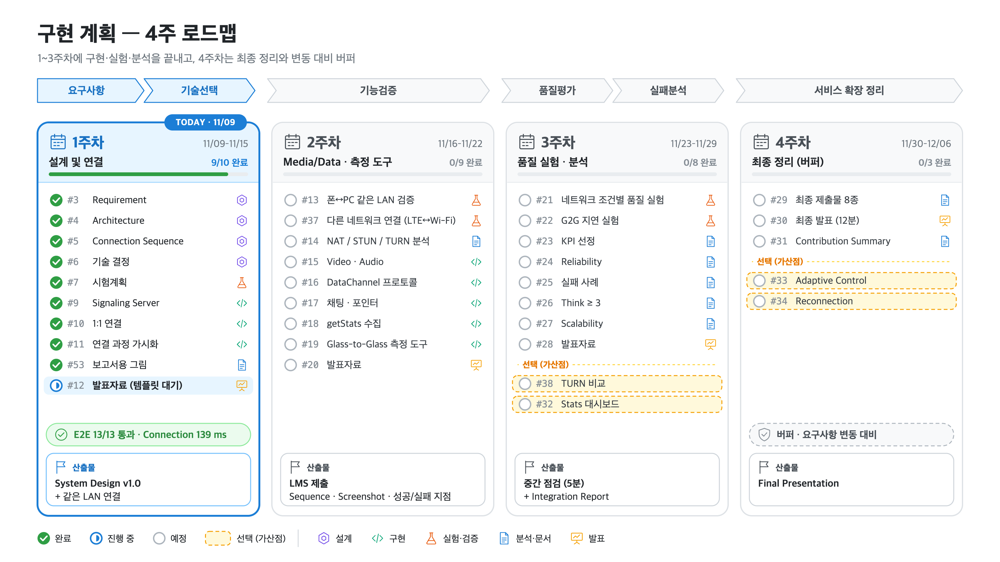

# 다이어그램

보고서·발표자료용 그림. 원본은 `src/*.html`(SVG + 공통 아이콘), PNG는 렌더링 결과다.

| 그림 | 원본 | 내용 |
|---|---|---|
|  | `src/system-architecture.html` | 시스템 아키텍처: 현장·전문가·NAT·시그널링·ngrok·STUN·TURN·P2P |
|  | `src/client-modules.html` | 클라이언트 모듈 구조와 브라우저 API |
|  | `src/server-config.html` | 서버 구성도: 개발자 PC의 Node 프로세스, 엔드포인트, LAN·ngrok 접속 경로, STUN/TURN |
|  | `src/implementation-plan.html` | 구현 계획 4주 로드맵 (데이터 기반: `status`, `TODAY`만 고치면 됨) |

## 수정과 렌더링

```bash
npm run diagrams                 # 전체
npm run diagrams client-modules  # 하나만
```

- 설치된 Google Chrome을 헤드리스로 띄워 `#diagram`(1600×900)을 2배 해상도 PNG로 저장한다 (`server/scripts/render-diagrams.mjs`).
- 아이콘은 `src/icons.js`에 직접 그린 선 아이콘(48×48)이다. SVG 안에서 `<use href="#i-phone" x y width height color/>`로 쓴다.
- 색: 현장 주황, 전문가 파랑, 시그널링 보라, P2P 미디어 초록, STUN 회색, TURN 노랑(점선 = 선택).
