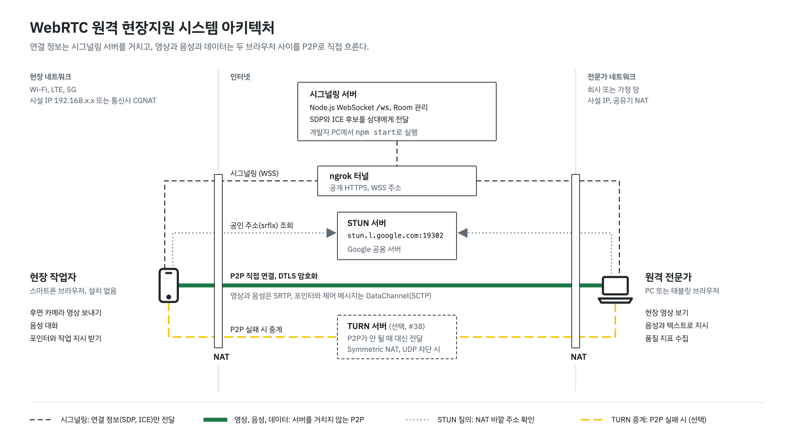
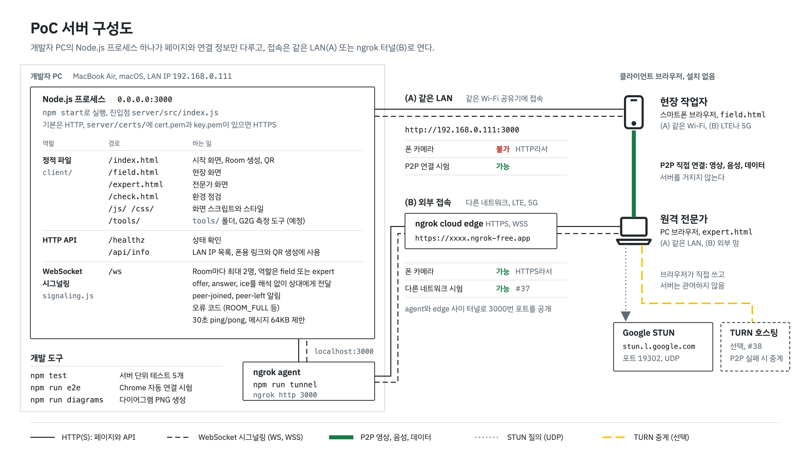
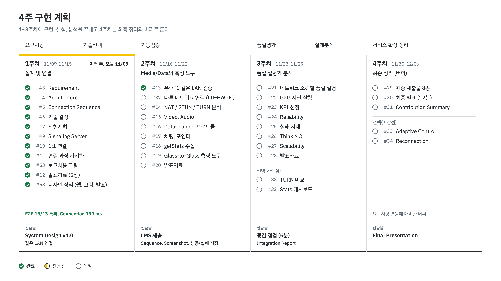
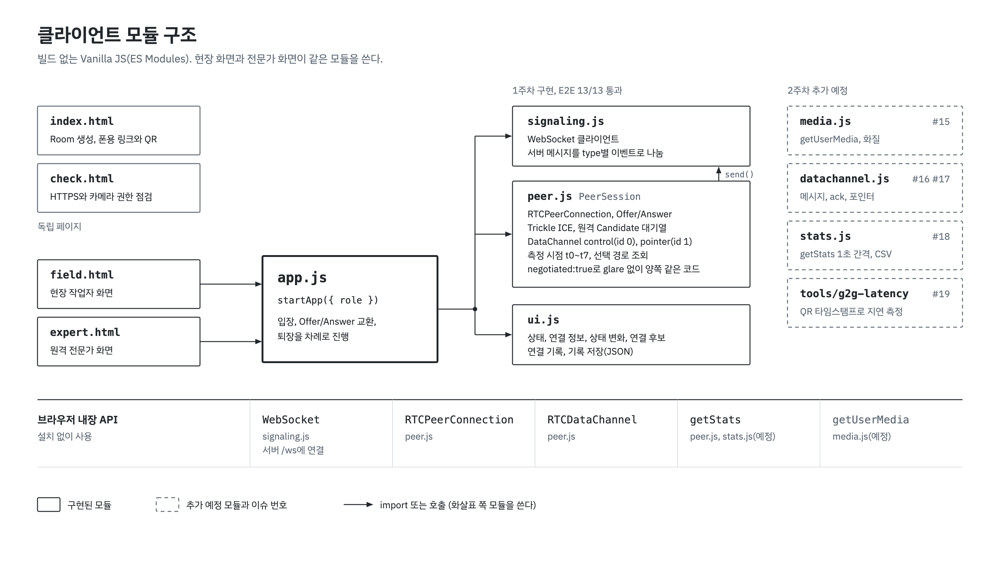
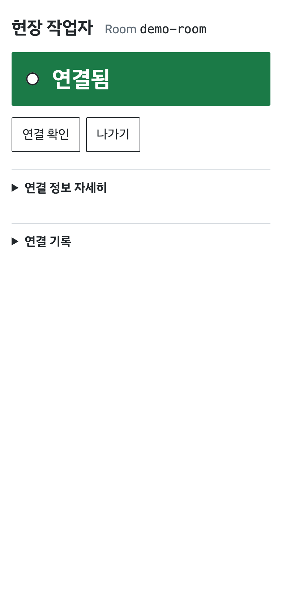
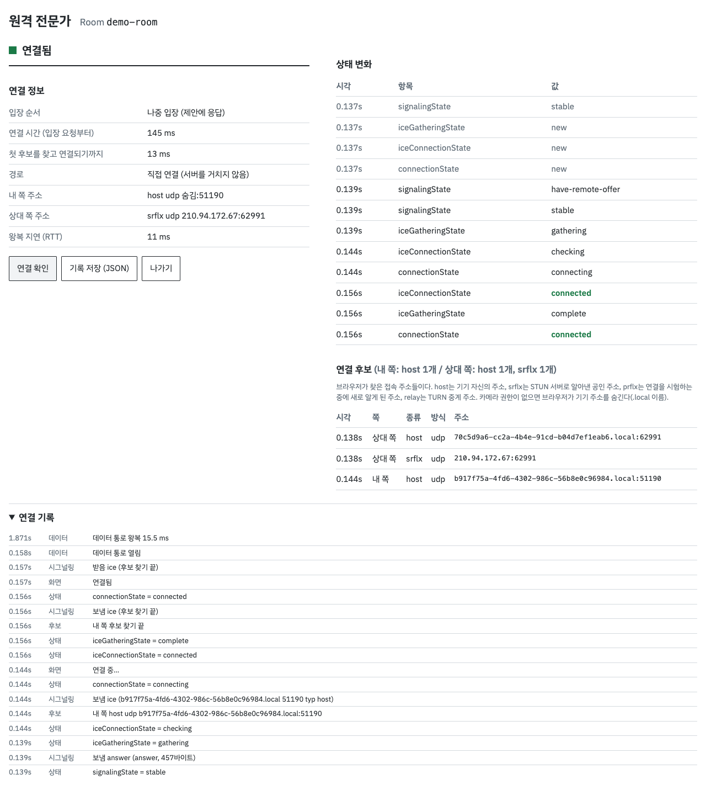
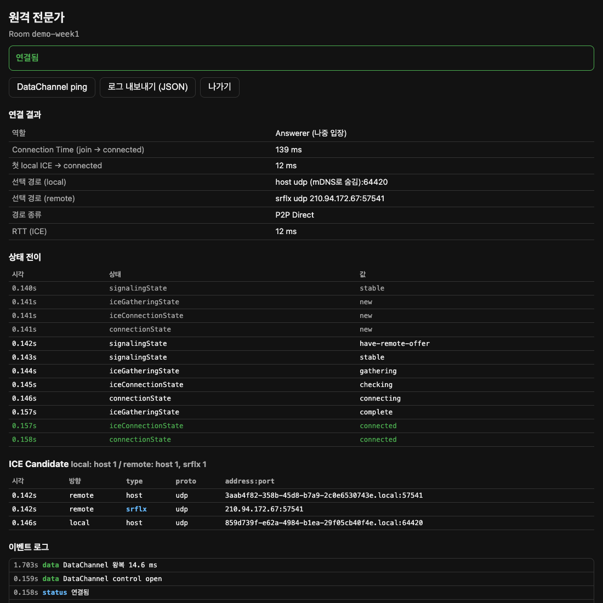
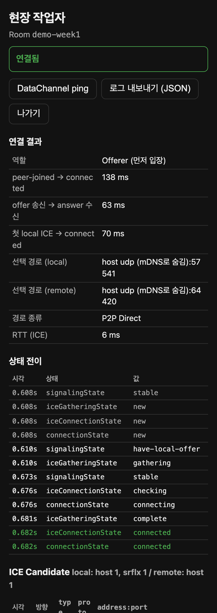

# 1주차 보고서 — 설계 및 연결

> 기간: 2026-11-09 ~ 11-15 · Milestone: 1주차 · 설계 및 연결 · 작업(PR)마다 갱신한다.

## 이번 주 목표

1. System Design v1.0 완성 (Requirement, Architecture, Connection Sequence, 기술 결정, PoC·시험계획)
2. 같은 네트워크에서 브라우저 두 개를 WebRTC로 연결
3. Progress Check 발표자료 (1장, 3분)

## 진행 현황

| 구분 | 이슈 |
|---|---|
| 완료 | #1 계획 · #36 범위 변경 · #3 Requirement · #4 Architecture · #5 Connection Sequence · #6 기술 결정 · #7 시험계획 · #9 Signaling Server · #46 1인 진행·보고서 · #10 1:1 연결 · #11 연결 과정 가시화 · #51 문서 정리 · #53 보고서용 그림 · #13 iPhone·iPad↔PC 연결 시험(2주차 작업을 앞당김) · #12 발표자료 · #58 디자인 정리 |
| 진행 중 | #2 개발 환경 (폰 HTTPS 확인 남음) |
| 남음 | 없음 (폰 HTTPS 카메라 확인은 2주차 #15에서) |
| 제외 | #8 역할분담 (1인 진행) |

## 작업 기록

| 날짜 | 이슈 · PR | 한 일 | 결과 · 근거 |
|---|---|---|---|
| 11/09 | #1 · PR #35 | 과제 명세 분석, 4주 계획, 이슈 34개·Milestone 4개, Git 컨벤션, 저장소 골격 | `docs/PROJECT_PLAN.md`, `CONTRIBUTING.md` |
| 11/09 | #36 · PR #39 | 다른 네트워크 간 연결 시험을 범위에 포함, #37·#38 추가 | NAT 통과 P2P가 WebRTC의 핵심이라 판단. ngrok으로 비용 없이 시험 가능 |
| 11/09 | #2 · PR #40 | Node 정적 서버, `check.html`(HTTPS·카메라 점검), ngrok 스크립트 | PC에서 `/healthz`·페이지 200, 경로 조작 차단 확인 |
| 11/09 | #3 · PR #41 | Requirement v1.0: 시나리오, FR-01~12, 데이터별 요구 특성, NFR | `docs/01-requirements.md` |
| 11/09 | #4 · PR #42 | Architecture v1.0: 구성도, 구성 요소별 필요 이유, Media/Data 배치, PoC 범위 | `docs/02-architecture.md` |
| 11/09 | #5 · PR #43 | Connection Sequence v1.0, Signaling 메시지 스펙, 실패 분기, 측정 시점 t0~t7 | `docs/03-connection-sequence.md` |
| 11/09 | #6 · PR #44 | 기술 결정 TD-01~12 (선택·대안·이유·단점) | `docs/04-tech-decisions.md` |
| 11/09 | #7 · PR #45 | 시험계획 T1~T5, KPI 후보 13개, 기록 규칙 | `docs/05-test-plan.md` |
| 11/09 | — | iPhone에서 `http://192.168.0.111:3000/check.html` 접속 시험 | 아래 '관찰' 참고 |
| 11/09 | #9 · PR #47 | WebSocket Signaling Server (Room, 중계, 오류 코드, ping/pong), 테스트 5개 | `npm test` 5/5 통과 |
| 11/09 | #46 · PR #48 | 1인 진행 반영, 주차별 보고서 규칙 | 이 문서 |
| 11/09 | #10 · PR #49 | 1:1 RTCPeerConnection: Offer/Answer, Trickle ICE(대기열), negotiated DataChannel 2개, ping/pong, 선택 경로 표시, 시작 화면(Room 생성, 폰용 LAN 링크·QR) | 헤드리스 Chrome E2E 10개 항목 통과 (`npm run e2e`). Connection Time 1114 ms, P2P Direct, RTT 0~4 ms |
| 11/09 | #11 · PR #50 | 상태 전이 시각표, ICE Candidate 표(type별 집계), 연결 결과 표, 로그 JSON 내보내기 | E2E 13개 항목 통과. 화면: `screenshots/expert-connected.png`, `field-connected.png` (Connection Time 139 ms, ICE RTT 12 ms, DataChannel 왕복 14.6 ms) |
| 11/09 | #51 | 과제 설명 PDF를 `docs/reference/`로 이동, #11 PR에서 빠진 문서 갱신 반영 | 루트 정리 |
| 11/09 | #53 | 보고서용 그림 4종: 시스템 아키텍처, 서버 구성도, 구현 계획(4주 로드맵), 클라이언트 모듈 구조. 직접 그린 아이콘 세트, `npm run diagrams`로 PNG 렌더링 | 아래 '그림' |
| 11/09 | #13 | iPhone(Chrome) ↔ Mac(Chrome) 같은 Wi-Fi 연결 10회 시험. PC 쪽 자동 측정 스크립트(`server/e2e/measure-connection.mjs`) 추가. 재연결 시 결과 표가 남는 버그 수정 | 9/9 P2P 직접 연결, Connection Time 중앙값 50.5 ms(40~102, 8회), ICE RTT 중앙값 9 ms, DataChannel 왕복 중앙값 21.8 ms. 10회째는 폰 앱 전환으로 중단. `experiments/2026-11-09_T1-iphone-pc-lan/` |
| 11/09 | #13 | iPad ↔ Mac 같은 Wi-Fi 연결 10회 시험, 서버가 접속 기기의 User-Agent를 기록하도록 수정 | 10/10 P2P 직접 연결, Connection Time 중앙값 46 ms(39~172, 9회), ICE RTT 중앙값 9 ms, DataChannel 왕복 중앙값 39.3 ms. `experiments/2026-11-09_T1-ipad-pc-lan/` |
| 11/09 | #12 | 1주차 발표자료 5장(표지, 시스템 구조, 연결 구현, 예상 난제, 남은 계획). 랩미팅 템플릿 사용, 모든 장에 발표자 노트 | `PBL2_1주차_261109.r1.pptx`. PowerPoint로 렌더링해 겹침·넘침 점검, 숫자는 실험 원자료와 대조 |
| 11/09 | #58 | 'AI 티 나는 디자인' 정리. Anthropic 공식 `frontend-design` 스킬 하나만 골라 설치하고, 그 절차대로 `docs/DESIGN.md`(설비 점검 태그, 계통도, 안전 색)를 만든 뒤 웹 화면 5개, 다이어그램 4종, 발표자료 r2를 다시 만듦 | 카드, 가운뎃점 나열, 문장 앞 화살표, 어두운 화면, 고정폭 라벨 제거. E2E 13/13 유지. 발표자료 `PBL2_1주차_261109.r2.pptx`, 화면 `docs/screens/` |

## 그림

### 시스템 아키텍처

### 서버 구성도

### 구현 계획

### 클라이언트 모듈 구조

### 새 디자인 화면 (#58)

| 현장 (폰, 연결됨) | 전문가 (PC) |
|---|---|
|  |  |

### 실행 화면 (같은 LAN 연결, 디자인 정리 전)

| 전문가 (PC) | 현장 (모바일 크기) |
|---|---|
|  |  |

## 결정 · 변경

| 결정 | 이유 |
|---|---|
| 일정 5주 → 4주, 4주차는 버퍼 | 마지막 주의 요구사항 변동 가능성 |
| 다른 네트워크 실측 제외 → **포함** | NAT 통과 P2P가 WebRTC의 핵심. ngrok으로 시그널링을 공개하면 시험 가능 |
| Glass-to-Glass 지연 측정 추가 | getStats RTT로는 사용자가 체감하는 종단 지연을 알 수 없음 |
| 1인 진행, 역할분담 없음 | 과제를 혼자 수행 |
| 발표자료는 팀 템플릿에 맞춰 작성 | 직접 디자인하지 않음 |
| 디자인 기준은 Anthropic `frontend-design` 하나 | 생성형 AI 티 제거. 여러 기준을 섞지 않음 (`docs/DESIGN.md`) |
| Offerer = Room에 먼저 있던 쪽, DataChannel은 `negotiated` id 고정 | glare 방지, Offerer가 누구든 같은 코드 |

## 관찰 · 문제

- **iPhone Chrome(CriOS 157)에서 HTTP로 접속하면 카메라 API가 없다.** `isSecureContext=false`이고 `navigator.mediaDevices`가 `undefined`다. 반면 `RTCPeerConnection`은 있으므로 카메라 없이 하는 같은 LAN 연결 시험은 HTTP로 가능하다. 카메라 시험은 HTTPS(ngrok)가 필요하다.
- **iOS의 Chrome은 WebKit 엔진**이라 `BarcodeDetector`가 없다. G2G의 QR 디코딩은 설계대로 PC(전문가) 쪽에서 한다.
- 저장소 루트에서 `npm run tunnel`을 실행하면 `package.json`이 없어 실패했다 → 루트 `package.json`을 추가해 해결 (PR #47).
- **카메라 권한이 없으면 host Candidate의 사설 IP가 mDNS 이름(`xxxx.local`)으로 숨겨진다.** getStats의 local 주소가 비어 나온다. 개인정보 보호 기능이며, 같은 LAN에서는 mDNS가 풀려 연결된다. 다른 네트워크 분석(#14) 때 고려한다.
- 같은 PC 두 브라우저 연결에서 전문가 쪽 local Candidate가 host 1개뿐이고 srflx가 수집되지 않았다(현장 쪽은 srflx 수집). 이 PC에 공인 IP 인터페이스(210.94.172.67)가 있어 srflx가 host와 같아 생략됐을 가능성이 있다. #14에서 확인한다.
- **실제 iPhone ↔ PC 연결 경로는 host(mDNS) ↔ prflx였다.** 상대의 host 주소가 mDNS 이름으로 숨겨져 있어서, 연결성 검사 패킷이 온 실제 주소를 새 후보(prflx, peer reflexive)로 배운 것이다.
- **연결 시점에 srflx 후보가 거의 없었다(9회 중 7회 host만).** 같은 LAN에서는 문제없지만 다른 네트워크에서는 srflx가 필요하다. #14에서 원인을 확인한다.
- Chrome DevTools 네트워크 제한은 WebRTC에 적용되지 않는다 → 품질 실험은 Network Link Conditioner를 쓴다 (`docs/05-test-plan.md`).

## 다음 할 일

